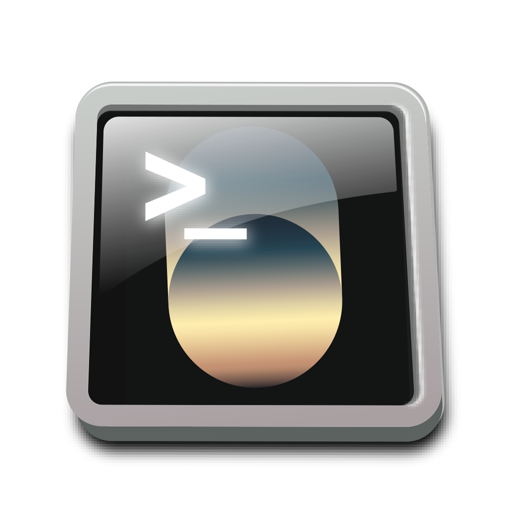
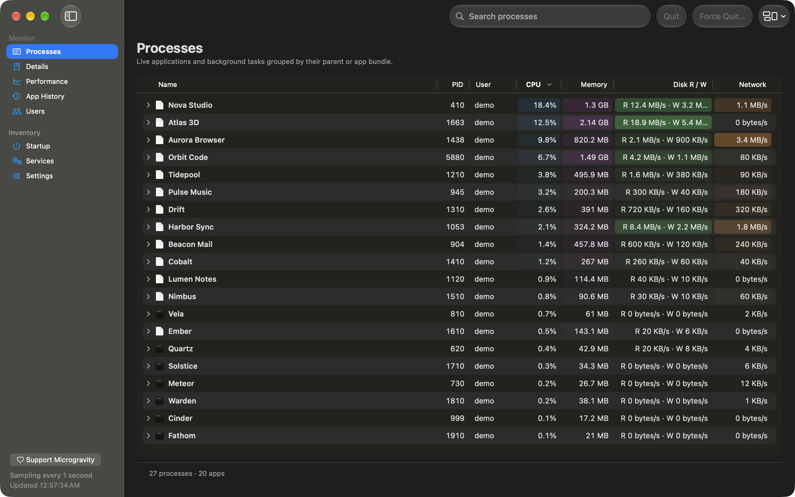
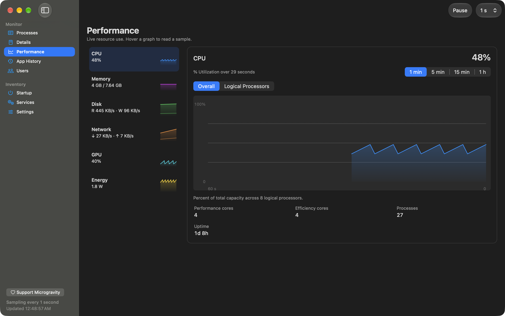
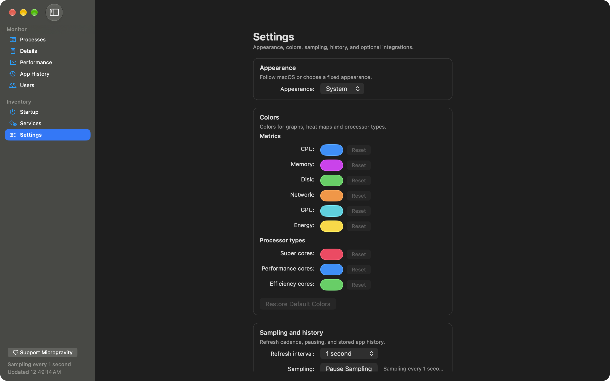
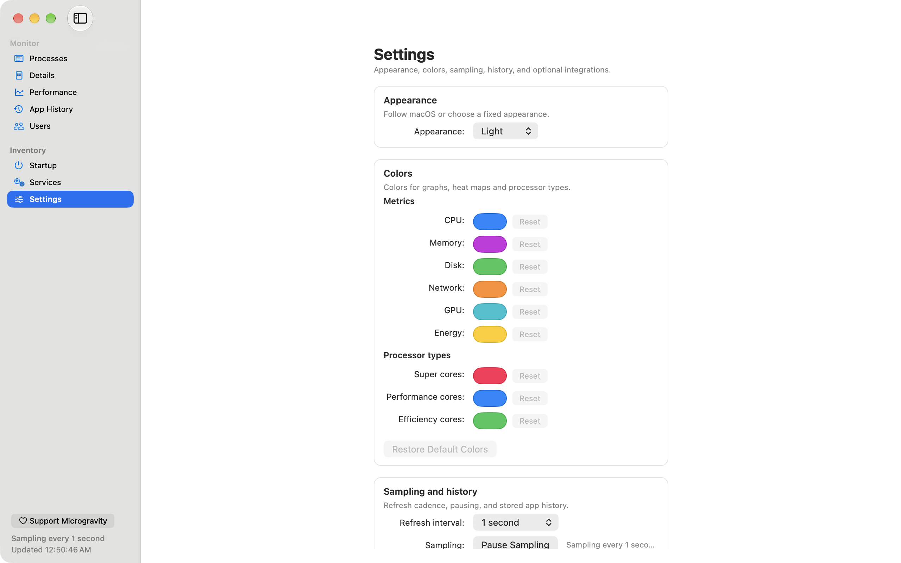

<p align="center">
  
</p>

# Microgravity

Microgravity is a free, open-source macOS process monitor — a native AppKit and Swift alternative to Activity Monitor and Task Manager. It groups processes by app and shows live CPU, memory, disk, and network activity, with system-wide GPU and energy graphs when the optional helper is enabled. Per-app CPU, disk, and network history is kept locally for up to 30 days. It runs on macOS 14 or later on Apple silicon and Intel Macs.

<p align="center">
  <a href="https://github.com/BurntToasters/Microgravity/releases/latest"></a>
  <a href="LICENSE"></a>
  
</p>

<p align="center">
  <a href="https://github.com/BurntToasters/Microgravity/releases/latest"></a>
</p>

<p align="center"><sub>Signed and notarized universal build · macOS 14 or later</sub></p>

<p align="center">
  
</p>
<p align="center"><sub>The Processes page: app groups, live resource columns, and heat-mapped cells.</sub></p>

<p align="center">
  
</p>
<p align="center"><sub>Performance: system-wide graphs, per-core activity, memory pressure, and GPU and energy readings where macOS reports them.</sub></p>

<p align="center">
  <a href="docs/screenshots/microgravity-settings-dark.png"></a>
  <a href="docs/screenshots/microgravity-settings-light.png"></a>
</p>
<p align="center"><sub>Settings follow macOS or use a fixed Light or Dark appearance. History stays on this Mac for up to 30 days.</sub></p>

**Contents**

- [Why Microgravity?](#why-microgravity) · [Install](#install)
- **Features:** [Process monitor](#process-monitor) · [Performance and GPU monitoring](#performance-and-gpu-monitoring) · [Per-app history](#per-app-history) · [Startup items and services](#startup-items-and-services) · [Users and process details](#users-and-process-details) · [Settings and privacy](#settings-and-privacy)
- [Frequently asked questions](#frequently-asked-questions) · [Privacy and permissions](#privacy-and-permissions) · [Verify releases](#verify-releases)
- [Build from source](#build-from-source) · [Contributing](#contributing) · [Help and support](#help-and-support) · [License](#license)

## Why Microgravity?

Activity Monitor is built into macOS and is still the quickest way to check one process. Microgravity is for a wider view: helpers grouped under the app that owns them, resource history that survives a relaunch, and startup, service, user, and process details in one window. Run both if you like; they read the same Mac.

| | Microgravity | Activity Monitor |
| --- | --- | --- |
| App grouping | Groups helper processes under their app, with an optional flat list | Parent/child process hierarchy |
| Per-app history | Up to 30 days of daily CPU, disk, and network totals, stored locally | Live graphs while open; no per-app history retention |
| Per-process GPU | Not collected; system GPU activity appears on the Performance page | `% GPU` and `GPU Time` columns where available |
| Per-process network | With the optional privileged helper, plus per-app history | Network tab, with per-process totals since each process started |
| Heat-mapped columns | CPU, memory, disk, and network | No background heat maps |
| Startup items and services | Read-only inventory of login items, launch agents, daemons, and services | Not included |
| Open source | GPL-3.0-only | Proprietary |
| Price | Free | Included with macOS |

## Install

1. [Download the latest release](https://github.com/BurntToasters/Microgravity/releases/latest). The release asset is a ZIP archive.
2. Unzip it and drag `Microgravity.app` into Applications.
3. Open Microgravity. The build is signed with a Developer ID and notarized by Apple.

**System requirements:** macOS 14 or later. One universal build runs natively on Apple silicon and Intel Macs.

The optional privileged helper, open-at-login item, and update checks are managed in Settings. The app runs without the helper; metrics that need it are labeled unavailable.

## Process monitor

By default, Microgravity groups processes by app, so browser helpers, Electron subprocesses, and other children sit under the app they belong to. Switch to Flat List when you want every PID in one table. Search matches process name, executable path, PID, or owner.

The CPU, memory, disk read/write, and network columns can be sorted. CPU, memory, disk, and network cells use background heat maps. Microgravity does not collect per-process GPU time; the Performance page shows system-wide GPU activity instead. Quit and Force Quit act on the selected process; protected and root-owned processes are refused with an explanation. Other standard users' processes can be quit after administrator approval through the optional helper. Finder can be relaunched from the same page. Missing metrics carry a reason instead of appearing as zero.

## Performance and GPU monitoring

Performance shows live CPU, memory, disk, network, GPU, and energy graphs with 1-minute, 5-minute, 15-minute, and 1-hour windows. A detail view adds per-logical-processor activity, swap usage, and a memory-pressure timeline. Hover a graph to read a sample; paused or missed samples appear as gaps.

GPU activity is system-wide, and per-process GPU time is not collected. GPU and energy readings require the optional helper, and energy is marked unavailable when macOS does not provide the expected power data.

## Per-app history

App History keeps daily totals for each app: CPU time, disk reads and writes, and network receive and transmit. Up to 30 days are stored in a local SQLite database, so history survives a relaunch. Expand an app to inspect each day; gaps and counter resets are labeled.

Reset App History in Settings to clear the stored totals. History is aggregate data, not an event log: command lines, socket destinations, and per-sample details are not stored.

## Startup items and services

Startup is a read-only inventory of login items, launch agents, and launch daemons. Services lists macOS services. Both show name, kind, status, owner, and known path, and can reveal the selected item in Finder or open Login Items settings.

macOS may protect some locations. When discovery is incomplete, the page reports the limitation rather than presenting an empty list as complete.

## Users and process details

Users combines active login sessions with every account that owns a process, then totals process count, CPU, and memory per account. Details is a flat, searchable process table with PID, owner, parent PID, CPU, memory, disk, network, and executable path. Both pages label unavailable data with a reason.

## Settings and privacy

Settings covers appearance (System, Light, or Dark), colors for graphs, heat maps, and processor types, a 0.5-, 1-, 2-, or 5-second refresh interval, pause and resume, and history reset. Optional integrations report their real state: the privileged helper, open at login, and software updates. Reset All Settings restores preferences without deleting app history, the helper, or the login item.

Microgravity has no account and no analytics. It samples locally, stores aggregate history in a local SQLite database, and the app itself makes network requests only for update checks. Read [Privacy and permissions](#privacy-and-permissions) for the helper and macOS approvals.

## Frequently asked questions

### Is Microgravity an Activity Monitor alternative?

Yes. It is a free, open-source macOS process monitor that covers the everyday jobs of Activity Monitor — finding resource-heavy processes, viewing system-wide CPU, memory, disk, and network activity, and quitting processes — and adds app grouping, up to 30 days of per-app history, and startup and service inventories. GPU and energy readings also appear when the optional helper is enabled. Activity Monitor is built into macOS; Microgravity is a separate download.

### How do I find what is using CPU, GPU, or memory?

Open Processes and sort by CPU or Memory, or search by name, path, PID, or user. The Performance page shows system-wide trends; GPU activity is system-wide, not per process. For a flat, searchable list, use Details. GPU and energy readings need the optional helper.

### How long does Microgravity keep history?

Up to 30 days of daily per-app CPU, disk, and network totals. History is stored locally and survives relaunch. It is aggregate data, so it does not keep a per-sample event log. Reset App History in Settings clears it.

### Does per-process network monitoring require the helper?

Yes. Per-process network byte totals come from `nettop` through the optional privileged helper; without it, the network column is marked unavailable. System-wide network rates work without the helper.

### Does Microgravity run on Apple silicon and Intel Macs?

Yes. One universal build supports both, on macOS 14 or later. Some advanced readings depend on hardware and macOS support; Microgravity labels unavailable metrics instead of showing zero.

### Is Microgravity free and open source, and what data does it collect?

Microgravity is free and licensed GPL-3.0-only. It has no account and no analytics. Measurements and aggregate app history stay on your Mac; the app's only automatic network request is an update check. The optional helper is code-signed, authenticates the app, and can quit other standard users' processes only after administrator approval. See [Privacy and permissions](#privacy-and-permissions) and the [advanced metrics documentation](docs/ADVANCED_METRICS.md).

## Privacy and permissions

Microgravity collects measurements on your Mac. App History stores daily aggregate totals plus app display names and bundle paths in a local SQLite database; it does not store command lines or network destinations. There is no account, no telemetry, and no analytics service. The app's only automatic network request is an update check.

The optional privileged helper adds per-process network totals, GPU activity, and energy readings. It is code-signed and checks the app's signature; the app checks the helper. The helper can quit processes owned by other standard users, but never root-owned processes, PID 1, itself, or processes in protected system locations. macOS asks for administrator approval for each such quit. You can remove the helper from Settings.

The login item can also ask macOS for approval, and the update state is reported in Settings. Some metrics and inventory locations depend on permissions or platform support, and the interface marks those states instead of showing zero or an empty list. For the fixed commands, code-signing requirements, termination authorization, and logging, read [how Microgravity collects advanced metrics and protects the helper](docs/ADVANCED_METRICS.md).

## Verify releases

Release builds are signed with a Developer ID Application certificate and notarized by Apple. Each release also includes `SHA256SUMS` and detached GPG signatures (`.asc`). The Microgravity GPG public key is at <https://tuxedo.rosie.run/GPG/Microgravity_1C2EC359.asc>; its fingerprint is `F01DAAD63F4688AB0BBEC7085E7752731C2EC359`.

Download the key, the release archive, `SHA256SUMS`, and `SHA256SUMS.asc`, then verify:

```sh
gpg --import Microgravity_1C2EC359.asc
gpg --verify SHA256SUMS.asc SHA256SUMS
shasum -a 256 -c SHA256SUMS --ignore-missing
```

In-app updates are delivered by [Sparkle](https://sparkle-project.org) and verified with an EdDSA signature before they install.

## Build from source

1. Install Xcode 26 or later and Node.js 24.13 or later.
2. `npm ci`
3. `npm run build:debug`

The unsigned development app is written to `DerivedData/Build/Build/Products/Debug/Microgravity.app`.

`npm run test:all` runs the Core and UI XCTest suites; `npm run test:all -- --skip-ui` leaves out the UI suite, and releases use that by default. The UI tests need a signed build, a logged-in desktop session, and UI automation permission. The non-UI checks, signing, and release process are in the [release and signing procedure](docs/RELEASING.md).

## Contributing

Contributions are welcome. Read [CONTRIBUTING.md](CONTRIBUTING.md) for build and test commands, coding style, the pull request process, and GPL-3.0 contribution terms. By participating, you agree to the [Code of Conduct](CODE_OF_CONDUCT.md). Report security issues privately as described in [SECURITY.md](SECURITY.md), not in a public issue.

## Help and support

- **Product page:** <https://rosie.run/microgravity> — overview, screenshots, and download links.
- **Help center:** <https://help.rosie.run/microgravity/en-us> — setup and troubleshooting.
- **GitHub Issues:** <https://github.com/BurntToasters/Microgravity/issues> — bug reports and feature requests.
- **Star the repository:** <https://github.com/BurntToasters/Microgravity> — if Microgravity is useful, a star helps other Mac users find it.
- **General contact:** <https://help.rosie.run/contact>.
- **Support development:** <https://rosie.run/support>.

## License

Microgravity is licensed under `GPL-3.0-only`; see [LICENSE](LICENSE), [NOTICE.md](NOTICE.md) and [THIRD_PARTY_NOTICES.md](THIRD_PARTY_NOTICES.md). Sparkle is vendored under its upstream license terms; see the third-party notices for details.

Copyright © 2026 BurntToasters and Microgravity contributors.
