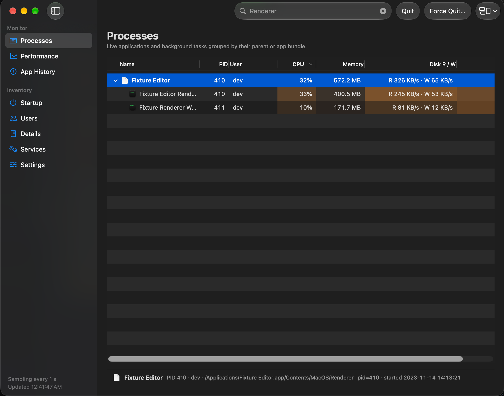
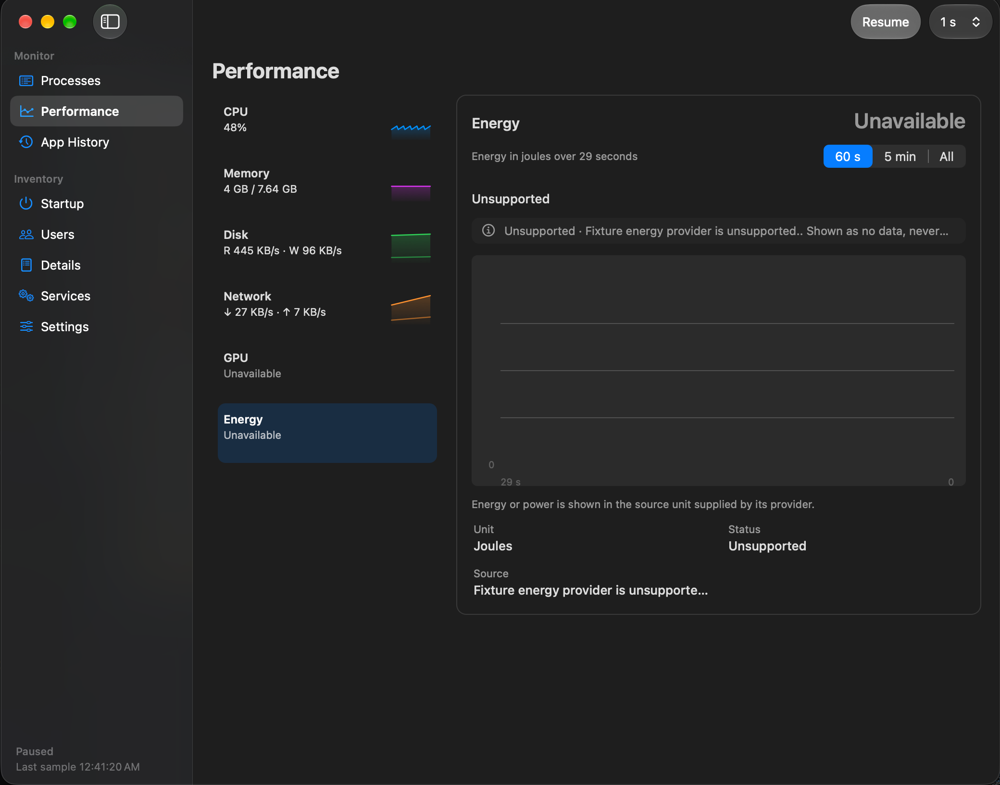
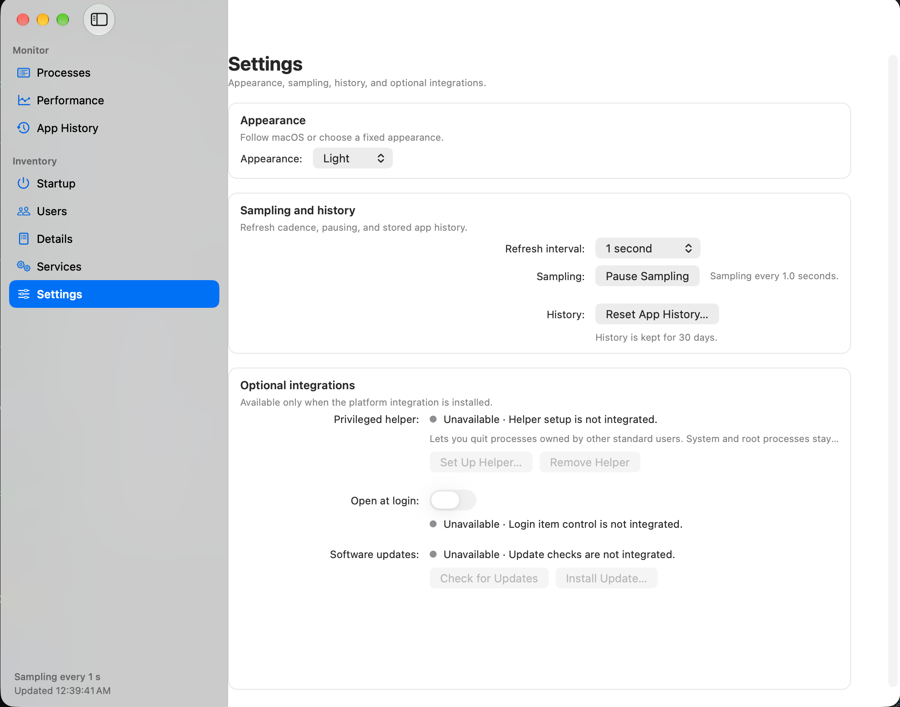
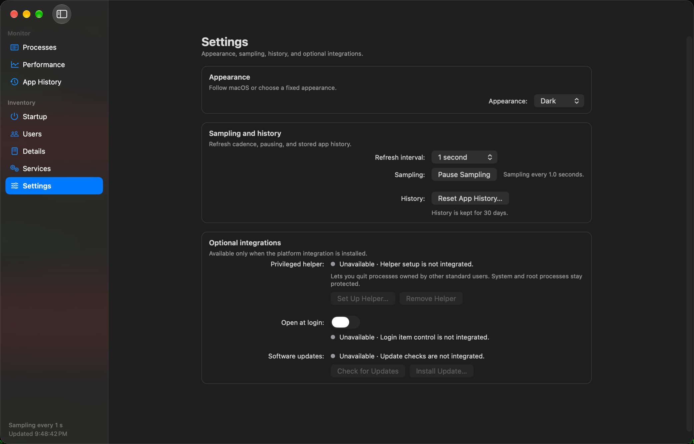

# Microgravity

Microgravity is a native process and system monitor for macOS, built with AppKit and Swift.

  
  &nbsp;
  
  &nbsp;
  
  &nbsp;
  

# Features

- **Processes:** An outline of every process, grouped by app or as a flat list, with app icons, heat-mapped resource columns, and Quit and Force Quit for the selected process.
- **Performance:** Sparklines and detail graphs for CPU, memory, disk, network, GPU and energy (where supported), per-core activity, swap and a memory pressure timeline.
- **App History:** Per-app resource use by day, kept locally for up to 30 days.
- **Startup and Services:** Read-only inventories of login items, launch agents and daemons, with Reveal in Finder.
- **Users and Details:** CPU and memory per user session, and a searchable per-process table with PID, user, CPU, memory, disk, network and GPU.
- **Settings:** Appearance, refresh interval, pause and resume sampling, history reset, the optional helper, the login item and updates.

Partial or unavailable measurements are labeled with a reason. Missing values are never shown as zero.

## System requirements

- macOS 14 or later.
- One universal build runs natively on Apple silicon and Intel Macs.

## Data and permissions

Microgravity collects process and system measurements on your Mac and keeps aggregate history locally for up to 30 days. Nothing is sent anywhere except update checks. Settings can pause sampling and reset history.

The optional privileged helper, login item and updates report their state in Settings and may ask for macOS approval. The helper can quit processes owned by other standard users; it never quits root-owned processes or processes in protected system locations. Some metrics and inventory locations depend on platform support or permissions, and the interface marks those states instead of showing zero or an empty list.

# Verify releases

> [!IMPORTANT]
> Releases are signed with my Apple Developer ID and notarized by Apple.
> Each release also ships `SHA256SUMS` and detached GPG signatures (`.asc`). Verify them with the Microgravity GPG public key:
> https://tuxedo.rosie.run/GPG/Microgravity_1C2EC359.asc (fingerprint `F01DAAD63F4688AB0BBEC7085E7752731C2EC359`).
> In-app updates are delivered by [Sparkle](https://sparkle-project.org) and verified with an EdDSA signature before they install.

# Build from source

1. Install Xcode 26 or later and Node.js 24.13 or later.
2. `npm ci`
3. `npm run build:debug`

The unsigned development app is written to `DerivedData/Build/Build/Products/Debug/Microgravity.app`.

`npm run test:all` runs the Core and UI XCTest suites; `npm run test:all -- --skip-ui` leaves out the UI suite, and releases use that by default. The UI tests need a signed build, a logged-in desktop session and UI automation permission. The non-UI checks, signing, and the release process are in [docs/RELEASING.md](docs/RELEASING.md).

# License

Microgravity is licensed under `GPL-3.0-only`; see [LICENSE](LICENSE), [NOTICE.md](NOTICE.md) and [THIRD_PARTY_NOTICES.md](THIRD_PARTY_NOTICES.md).

Copyright © 2026 BurntToasters and Microgravity contributors.

### ℹ️ Enjoying Microgravity? Consider [❤️ Supporting Me! ❤️](https://rosie.run/support)

# Need help with something?

If there is an issue with the app, feel free to create a **GitHub Issue**!
For other issues or general contact, go to [https://help.rosie.run/contact](https://help.rosie.run/contact).
